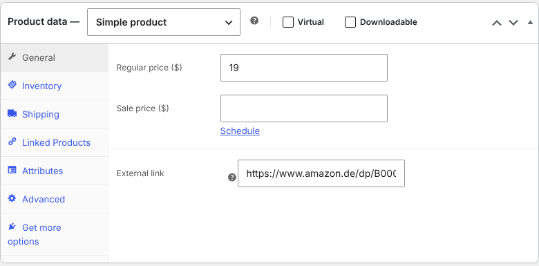

# Thumbnail Link for WooCommerce

[](https://github.com/Christianzimpel/thumbnail-link-for-woo/actions/workflows/ci.yml)
[](https://wordpress.org/plugins/thumbnail-link-for-woo/)
[](https://wordpress.org/plugins/thumbnail-link-for-woo/)
[](LICENSE)

WooCommerce plugin that links the product image and title in the shop to an external URL – handy for affiliate products.



## Features

- One extra field in *Product data → General*.
- Classic shop templates (`woocommerce_before_shop_loop_item`) **and** block themes (Product Collection: product image and post title blocks via `WP_HTML_Tag_Processor`).
- External links open in a new tab with `rel="noopener nofollow"`; products without a link behave as before.
- Saves through the WooCommerce CRUD API (`woocommerce_admin_process_product_object`) with URL validation and an admin error for invalid input.
- Declares compatibility with HPOS and the Cart/Checkout blocks, `Requires Plugins: woocommerce`.

## Filter

```php
add_filter( 'tlfw_link_attributes', function ( $attributes, $product ) {
	$attributes['rel'] = 'noopener sponsored';
	return $attributes;
}, 10, 2 );
```

## Development

```bash
composer install
composer lint      # WordPress Coding Standards
composer format    # auto-fix
```

Every push runs the coding standards, a PHP 7.4–8.4 syntax check and the official [Plugin Check](https://github.com/WordPress/plugin-check-action).

> The main file is still called `Woo-Thumb-Link.php`. Renaming it would deactivate the plugin for existing users on update, so the file-name sniff is ignored for this one file.

## Release

1. Bump `Version` in `Woo-Thumb-Link.php`, `TLFW_VERSION`, `Stable tag` in `readme.txt` and add a changelog entry.
2. Publish a GitHub release with the version as tag (e.g. `1.1.1`).
3. The [deploy workflow](.github/workflows/deploy.yml) checks that tag and version match, pushes trunk, tag and assets to WordPress.org SVN and attaches the ZIP to the release.

Requires the repository secrets `SVN_USERNAME` and `SVN_PASSWORD`.

## Background

Version 1.0.1 registered the save callback under a wrong function name, which caused a fatal error on PHP 8 whenever a product was saved. 1.1.0 fixes this and rewrites the plugin following the WordPress Coding Standards. See the [changelog](readme.txt).

## License

GPL-2.0-or-later © Christian Zimpel
